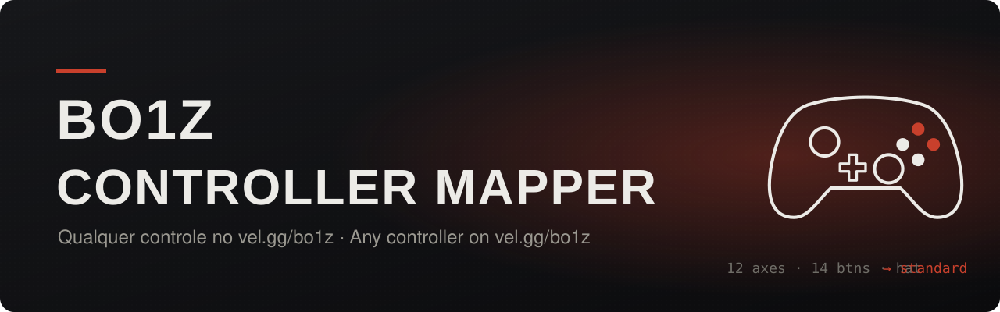
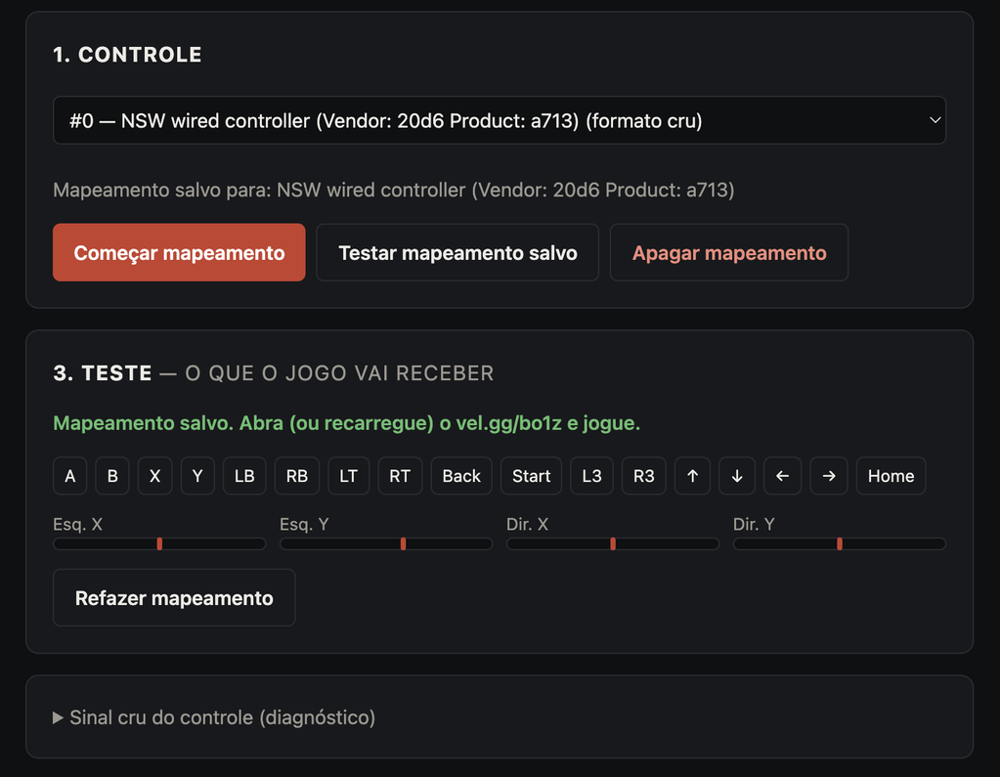
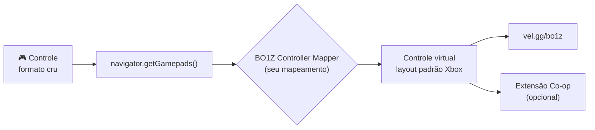

<div align="center">



### Seu controle não funciona no [vel.gg/bo1z](https://vel.gg/bo1z/)? Agora funciona.

Extensão gratuita para Chrome que ensina **qualquer controle** (Switch, PowerA, genéricos, 8BitDo…) a falar "Xbox" para o Black Ops 1 Zombies no navegador. Você mapeia uma vez, fica salvo.

[](https://github.com/Rahal-Gabriel/bo1z-controller-mapper/releases/latest/download/bo1z-controller-mapper.zip)


### [⬇ Baixar a extensão](https://github.com/Rahal-Gabriel/bo1z-controller-mapper/releases/latest/download/bo1z-controller-mapper.zip)

**Português** · [English](#english)

</div>

---

## 🎮 O problema

O vel.gg tem suporte a controle, mas só entende controles no **formato padrão** (layout de Xbox). Muitos controles chegam ao Chrome em **formato cru** — principalmente no **Mac** e com controles de **Switch** e genéricos:

| | Controle de Xbox / PS | Controle "cru" (ex.: PowerA de Switch no Mac) |
|---|---|---|
| Formato | `standard` | *(vazio)* |
| Eixos | 4 | 12 |
| Botões | 17 | 14 |
| Direcional | 4 botões | 1 eixo "hat" |
| No vel.gg | ✅ funciona | ❌ o navegador vê o controle, o jogo ignora |

Sintoma clássico: o site de teste mostra o controle **conectado**, mas no jogo **nada acontece**.

## ✨ A solução



- **Assistente passo a passo:** "aperte B", "empurre o analógico direito para a direita"… e pronto.
- **Salva sozinho** — faz uma vez só.
- **Tela de teste ao vivo** mostrando exatamente o que o jogo vai receber.
- **Corrige analógico descentralizado** (drift) e aceita **diagonais** no direcional.
- **Diagnóstico embutido:** mostra o sinal cru do controle e avisa se o seu sistema não está mandando os botões.
- **Funciona com e sem** a extensão [BO1 Zombies Co-op](https://github.com/AllanLotta/bo1-zombies-coop).
- Leve: nenhum servidor, nenhum dado sai do seu navegador. Só mexe no vel.gg.

<br clear="right">

## 📦 Instalar (2 minutos)

1. **[Baixe o zip](https://github.com/Rahal-Gabriel/bo1z-controller-mapper/releases/latest/download/bo1z-controller-mapper.zip)** e descompacte. Deixe a pasta `bo1z-controller-mapper` num lugar fixo (o Chrome continua usando ela).
2. Cole `chrome://extensions` na barra de endereço e ligue o **Modo do desenvolvedor** (canto superior direito).
3. Clique em **Carregar sem compactação** e escolha a pasta (a que tem o `manifest.json` dentro).
4. O assistente abre sozinho. 🎉

> O Chrome pode mostrar um aviso sobre extensões em modo desenvolvedor ao abrir — é normal, só fechar.

## 🕹️ Usar

1. Conecte o controle e **mexa um analógico** para ele aparecer no assistente.
2. Clique em **Começar mapeamento**, solte o controle por um segundo e siga os passos.
3. Confira na **tela de teste** se cada botão acende o quadradinho certo.
4. Abra (ou **recarregue**) o [vel.gg/bo1z](https://vel.gg/bo1z/), clique no jogo e aperte um botão.

Para reabrir o assistente: clique no ícone da extensão.

### Botões no jogo (controle de Switch)

| Switch | Vira (Xbox) | No jogo |
|---|---|---|
| **B** (baixo) | A | Pular |
| **A** (direita) | B | Agachar |
| **Y** (esquerda) | X | Recarregar · **segurar** = usar, comprar, **reparar barreira**, reviver |
| **X** (cima) | Y | Trocar arma |
| **ZR / ZL** | RT / LT | Atirar / mirar |
| **R / L** | RB / LB | Granada / granada tática |
| Clique analógico esq. / dir. | L3 / R3 | Correr / faca |
| **+ / −** | Start / Back | Pausar / placar |

## ⚙️ Como funciona



A extensão intercepta `navigator.getGamepads()` só na página do vel.gg e devolve o seu controle já traduzido para o [layout padrão do Gamepad API](https://w3c.github.io/gamepad/#remapping). O jogo e a extensão de co-op leem o controle a cada frame, então tudo "enxerga" um controle de Xbox comum — sem modificar nenhum dos dois.

## 🩺 Problemas

<details>
<summary><b>O assistente não detecta os botões, só os analógicos</b></summary>

Abra **"Sinal cru do controle"** no assistente. Se os `B0`, `B1`… nunca acendem ao apertar, o sistema não está repassando os botões desse controle para o Chrome — aí nenhum mapeamento resolve. Tente desconectar e reconectar o cabo e apertar o **Home**. Se continuar, use um app que transforme o controle em teclado/mouse.
</details>

<details>
<summary><b>Os botões ficaram trocados</b></summary>

Provavelmente algum passo foi feito com o botão errado. Clique em **Refazer mapeamento** — os passos dizem a letra do Switch e a posição do botão.
</details>

<details>
<summary><b>No jogo nada acontece</b></summary>

Recarregue a página do vel.gg depois de mapear, clique no jogo e aperte um botão do controle. No console do DevTools deve aparecer `[BO1Z Controller Mapper] mapeamento ativo para: …`.
</details>

## 🛠️ Desenvolvimento

```bash
npm test          # testa a captura e a tradução com um controle simulado
npm run package   # gera o zip da extensão
```

Estrutura: `extension/remap-core.js` (tradução), `extension/capture.js` (lógica do assistente), `extension/remap.js` (injetado no vel.gg), `extension/wizard.*` (assistente). Sem dependências.

PRs e issues são bem-vindos — principalmente relatos de controles testados.

---

<a name="english"></a>

## 🇺🇸 English

**Your controller doesn't work on [vel.gg/bo1z](https://vel.gg/bo1z/)? Now it does.**

vel.gg only understands controllers reported in the **standard** (Xbox) Gamepad layout. Many pads — especially **Switch-style and generic controllers on macOS** — reach Chrome in a **raw** layout (e.g. 12 axes, 14 buttons, D-pad as a "hat" axis). The browser sees them, the game ignores them.

This free Chrome extension fixes that:

- A **step-by-step wizard** records your controller once and saves it.
- On vel.gg it intercepts `navigator.getGamepads()` and hands the game a **virtual standard pad**.
- Fixes off-centre sticks, supports D-pad diagonals, includes a live test screen and raw-signal diagnostics.
- Works **with or without** [BO1 Zombies Co-op](https://github.com/AllanLotta/bo1-zombies-coop). No servers, no data leaves your browser.

**Install:** [download the zip](https://github.com/Rahal-Gabriel/bo1z-controller-mapper/releases/latest/download/bo1z-controller-mapper.zip), unzip it, open `chrome://extensions`, enable **Developer mode**, click **Load unpacked** and pick the folder. The wizard opens on its own (UI in Brazilian Portuguese).

**Use:** move a stick so the pad shows up → **Começar mapeamento** (start mapping) → follow the prompts → check the test screen → reload vel.gg/bo1z and press a button.

---

<sub>Projeto de fã, sem afiliação com Activision, Treyarch ou vel.gg. Call of Duty e Black Ops são marcas da Activision. · Fan project, not affiliated with Activision, Treyarch or vel.gg.</sub>
