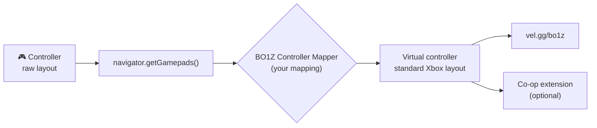

<div align="center">


### Your controller doesn't work on [vel.gg/bo1z](https://vel.gg/bo1z/)? Now it does.

A free Chrome extension that teaches **any controller** (Switch, PowerA, generic, 8BitDo…) to speak "Xbox" to Black Ops 1 Zombies in the browser. Map it once, it stays saved.

[](https://github.com/Rahal-Gabriel/bo1z-controller-mapper/releases/latest/download/bo1z-controller-mapper.zip)


### [⬇ Download the extension](https://github.com/Rahal-Gabriel/bo1z-controller-mapper/releases/latest/download/bo1z-controller-mapper.zip)

**English** · [Português](#português)

</div>

---

## 🎮 The problem

vel.gg supports controllers, but only ones reported in the **standard** Gamepad layout (Xbox style). Many controllers reach Chrome in a **raw** layout instead — especially on **macOS** with **Switch-style** and generic pads:

| | Xbox / PlayStation pad | "Raw" pad (e.g. PowerA Switch controller on Mac) |
|---|---|---|
| Mapping | `standard` | *(empty)* |
| Axes | 4 | 12 |
| Buttons | 17 | 14 |
| D-pad | 4 buttons | 1 "hat" axis |
| On vel.gg | ✅ works | ❌ the browser sees it, the game ignores it |

Classic symptom: a gamepad tester shows the controller as **connected**, but in game **nothing happens**.

## ✨ The fix


- **Step-by-step wizard:** "press B", "push the right stick to the right"… done.
- **Saves automatically** — you only do it once.
- **Live test screen** showing exactly what the game will receive.
- **Fixes off-centre sticks** (drift) and supports **D-pad diagonals**.
- **Built-in diagnostics:** shows the raw controller signal and warns you if your system isn't sending button presses.
- **Works with or without** the [BO1 Zombies Co-op](https://github.com/AllanLotta/bo1-zombies-coop) extension.
- **English and Portuguese**, picked from your browser language.
- Lightweight: no servers, no data leaves your browser. Only touches vel.gg.

<br clear="right">

## 📦 Install (2 minutes)

1. **[Download the zip](https://github.com/Rahal-Gabriel/bo1z-controller-mapper/releases/latest/download/bo1z-controller-mapper.zip)** and unzip it. Keep the `bo1z-controller-mapper` folder somewhere permanent (Chrome keeps using it).
2. Paste `chrome://extensions` into the address bar and switch on **Developer mode** (top right).
3. Click **Load unpacked** and pick the folder (the one with `manifest.json` inside).
4. The wizard opens on its own. 🎉

> Chrome may show a popup about developer-mode extensions when it starts — that's normal, just close it.
>
> The wizard speaks **English** or **Portuguese**, picked automatically from your browser language.

## 🕹️ Use

1. Plug in your controller and **move a stick** so it shows up in the wizard.
2. Click **Start mapping**, let go of the controller for a second, then follow the prompts.
3. On the **test screen**, check that each button lights up the right box.
4. Open (or **reload**) [vel.gg/bo1z](https://vel.gg/bo1z/), click the game and press a button.

To reopen the wizard later, click the extension icon.

### In-game buttons (Switch controller)

| Switch | Becomes (Xbox) | In game |
|---|---|---|
| **B** (bottom) | A | Jump |
| **A** (right) | B | Crouch |
| **Y** (left) | X | Reload · **hold** = use, buy, **repair barriers**, revive |
| **X** (top) | Y | Switch weapon |
| **ZR / ZL** | RT / LT | Fire / aim |
| **R / L** | RB / LB | Grenade / tactical grenade |
| Left / right stick click | L3 / R3 | Sprint / knife |
| **+ / −** | Start / Back | Pause / scoreboard |

## ⚙️ How it works



The extension intercepts `navigator.getGamepads()` on vel.gg only and returns your controller already translated to the [standard Gamepad API layout](https://w3c.github.io/gamepad/#remapping). The game and the co-op extension read the controller every frame, so everything sees a regular Xbox pad — without modifying either of them.

## 🩺 Troubleshooting

<details>
<summary><b>The wizard detects the sticks but not the buttons</b></summary>

Open **"Raw controller signal"** in the wizard. If `B0`, `B1`… never light up when you press buttons, your system isn't passing that controller's buttons to Chrome, and no mapping can fix that. Try unplugging and replugging the cable and pressing **Home**. If it still doesn't work, use an app that turns the controller into keyboard/mouse input.
</details>

<details>
<summary><b>Buttons are swapped</b></summary>

A step was probably done with the wrong button. Click **Redo mapping** — each step shows the Switch letter and the button's position.
</details>

<details>
<summary><b>Nothing happens in game</b></summary>

Reload the vel.gg page after mapping, click the game and press a controller button. The DevTools console should show `[BO1Z Controller Mapper] mapping active for: …`.
</details>

## 🛠️ Development

```bash
npm test          # tests capture and translation with a simulated raw controller
npm run package   # builds the extension zip
```

Layout: `extension/remap-core.js` (translation), `extension/capture.js` (wizard logic), `extension/remap.js` (injected into vel.gg), `extension/wizard.*` (wizard UI). No dependencies.

Issues and PRs are welcome — especially reports of controllers you've tested.

---

<a name="português"></a>

## 🇧🇷 Português

**Seu controle não funciona no [vel.gg/bo1z](https://vel.gg/bo1z/)? Agora funciona.**

O vel.gg só entende controles no formato **padrão** (layout de Xbox). Muitos controles — principalmente **de Switch e genéricos no Mac** — chegam ao Chrome em formato **cru** (ex.: 12 eixos, 14 botões, direcional como eixo "hat"). O navegador vê o controle, mas o jogo ignora.

Esta extensão gratuita resolve:

- Um **assistente passo a passo** registra o seu controle uma vez e salva.
- No vel.gg, ela intercepta o `navigator.getGamepads()` e entrega ao jogo um **controle virtual no formato padrão**.
- Corrige analógico descentralizado, aceita diagonais no direcional, tem tela de teste ao vivo e diagnóstico do sinal cru.
- Funciona **com e sem** a extensão [BO1 Zombies Co-op](https://github.com/AllanLotta/bo1-zombies-coop). Nenhum servidor, nenhum dado sai do navegador.

**Instalar:** [baixe o zip](https://github.com/Rahal-Gabriel/bo1z-controller-mapper/releases/latest/download/bo1z-controller-mapper.zip), descompacte, abra `chrome://extensions`, ligue o **Modo do desenvolvedor**, clique em **Carregar sem compactação** e escolha a pasta. O assistente abre sozinho.

**Usar:** mexa um analógico para o controle aparecer → **Começar mapeamento** → siga os passos → confira na tela de teste → recarregue o vel.gg/bo1z e aperte um botão.

**Reparar barreiras:** segure o **Y** (Switch), que vira o X do Xbox: usar / reparar / recarregar.

---

<sub>Fan project, not affiliated with Activision, Treyarch or vel.gg. Call of Duty and Black Ops are trademarks of Activision. · Projeto de fã, sem afiliação com Activision, Treyarch ou vel.gg.</sub>
